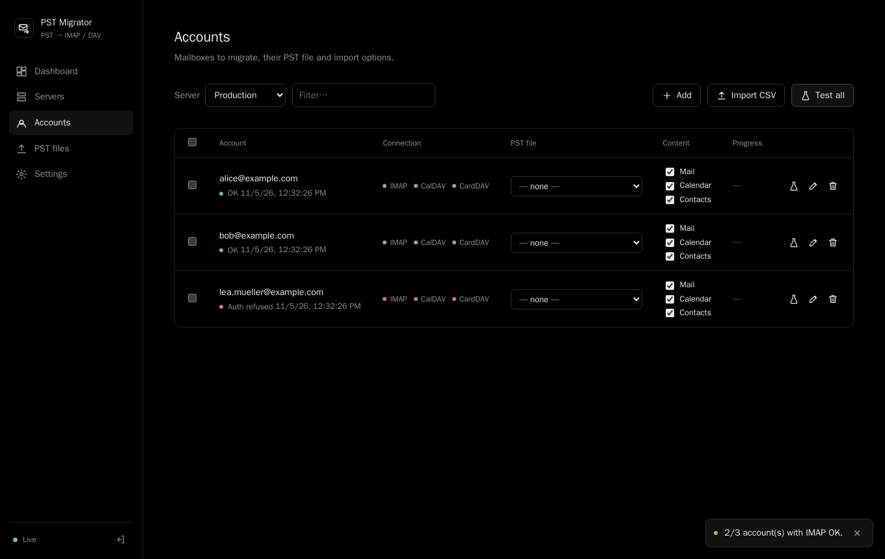

<p align="center"></p>

<h1 align="center">mccb</h1>

<p align="center">PST Migrator — bulk-migrate Outlook PST files to IMAP, CalDAV and CardDAV from a web dashboard.</p>

<p align="center">
  <a href="https://github.com/yetysw/mccb/releases"></a>
  <a href="https://github.com/yetysw/mccb/actions/workflows/docker.yml"></a>
  <a href="LICENSE"></a>
  <a href="https://github.com/yetysw/mccb/pkgs/container/mccb"></a>
</p>

<p align="center"></p>

## Features

- Migrate PST files to **IMAP** mail, **CalDAV** calendars and **CardDAV** contacts, from a web dashboard.
- **Resumable uploads**, built for 50 GB+ PSTs.
- Every message is **verified**; every language and charset is preserved.
- **Pause, resume and retry** with no duplicates.

## Quick start

```bash
mkdir mccb && cd mccb
curl -fsSLO https://raw.githubusercontent.com/yetysw/mccb/main/docker-compose.yml
docker compose up -d
docker compose logs web | grep -A2 "Admin password"
```

Pin a version by replacing `latest` with `1.0.0` in `docker-compose.yml`. To update: `docker compose pull && docker compose up -d`.

Open **http://\<host\>:22362** and sign in with the printed password. Change it under **Settings**, or set the `ADMIN_PASSWORD` environment variable.

## Usage

1. **Add a server**: IMAP host, security, and optional CalDAV/CardDAV URLs.
2. **Add accounts**, one by one or by CSV (`email;password[;login]`).
3. **Upload a PST** and check it with **Preview** (accents, attachments, images).
4. **Assign** the PST to an account.
5. **Run**, then read the report.

## Configuration

All variables are optional (set them in `.env`, see [`.env.example`](.env.example)).

| Variable | Default | Purpose |
|----------|---------|---------|
| `ADMIN_PASSWORD` | generated | UI password; always wins when set |
| `SECRET_KEY` | generated in `data/secret.key` | Encrypts mailbox passwords, signs sessions |
| `WORKER_CONCURRENCY` | `2` | Mailboxes migrated in parallel |
| `UPLOAD_CHUNK_SIZE` | `33554432` | Upload chunk size in bytes; keep constant during a migration |
| `COOKIE_SECURE` | `0` | `1` behind an HTTPS reverse proxy |

Everything else, including data layout and resuming internals: [docs/OPERATIONS.md](docs/OPERATIONS.md).

## Reverse proxy

Port 22362 speaks plain HTTP; do not expose it directly. Disable request buffering, allow chunk-sized bodies and use long timeouts.

```nginx
client_max_body_size 64m;
proxy_request_buffering off;
proxy_read_timeout 3600s;
proxy_send_timeout 3600s;
```

Also disable buffering for `/api/events` (SSE). Full nginx, Caddy and Traefik notes are in [docs/OPERATIONS.md](docs/OPERATIONS.md#behind-a-reverse-proxy).

## Development

```bash
git clone https://github.com/yetysw/mccb.git && cd mccb
docker compose up -d --build
docker compose -f docker-compose.test.yml run --rm --build tests
```

API reference and specification: [docs/SPEC.md](docs/SPEC.md).

## Limitations

- Single administrator, SQLite on a local disk: one host, no high availability.
- Items with no charset information at all may decode imperfectly for some languages (e.g. Baltic); items that declare their codepage are preserved in every script.
- A corrupted PST can crash libpff; affected items are skipped and reported.

## License

[MIT](LICENSE)
