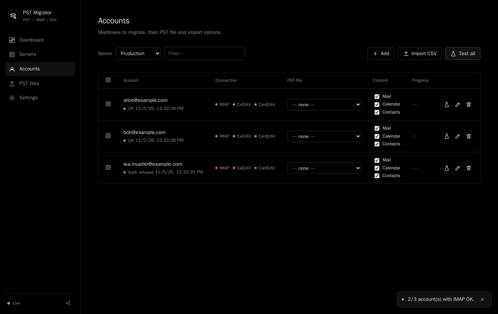

# mccb

mccb migrates Outlook PST files to IMAP mailboxes, CalDAV calendars and CardDAV address books, from a web dashboard. It is built for batches of mailboxes and very large PST files (resumable uploads).

Start here:

- [Install mccb](install.md) with Docker Compose and sign in.
- [Migrate a mailbox](migrate.md): add a server, add accounts, upload a PST, run.
- [Pause, resume and retry](resume.md): how an interrupted import continues without duplicates.

mccb is MIT licensed, with no paid edition. Read [Known limitations](limits.md) before relying on it.
